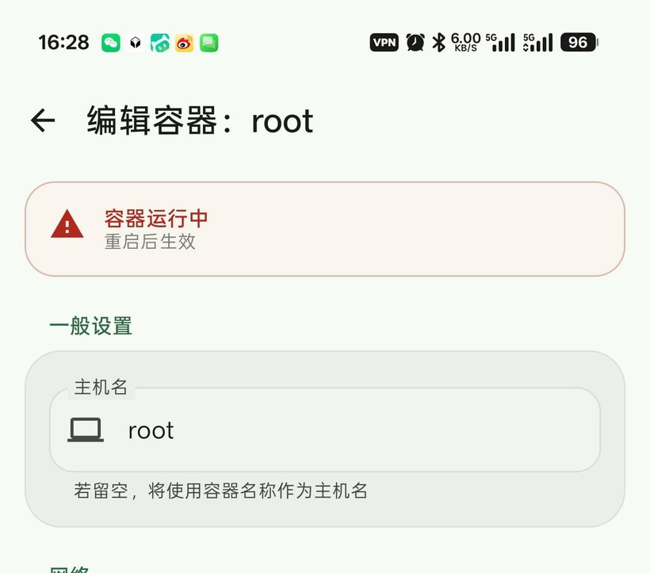
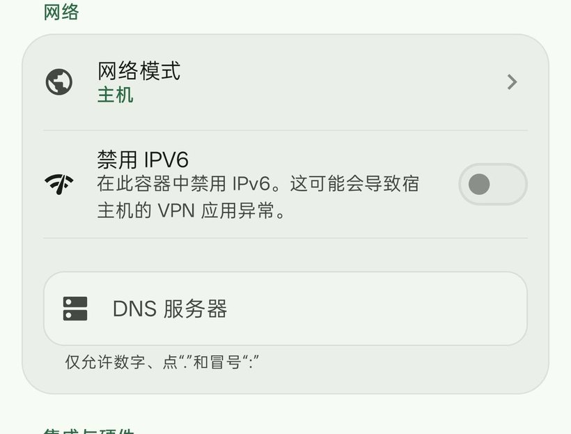
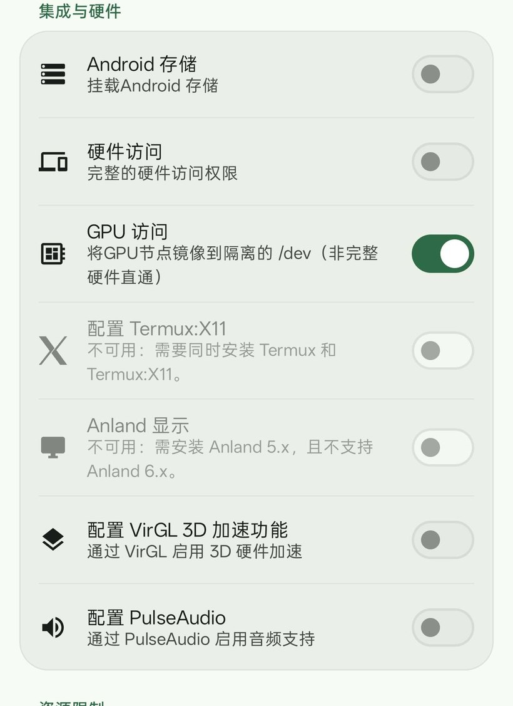
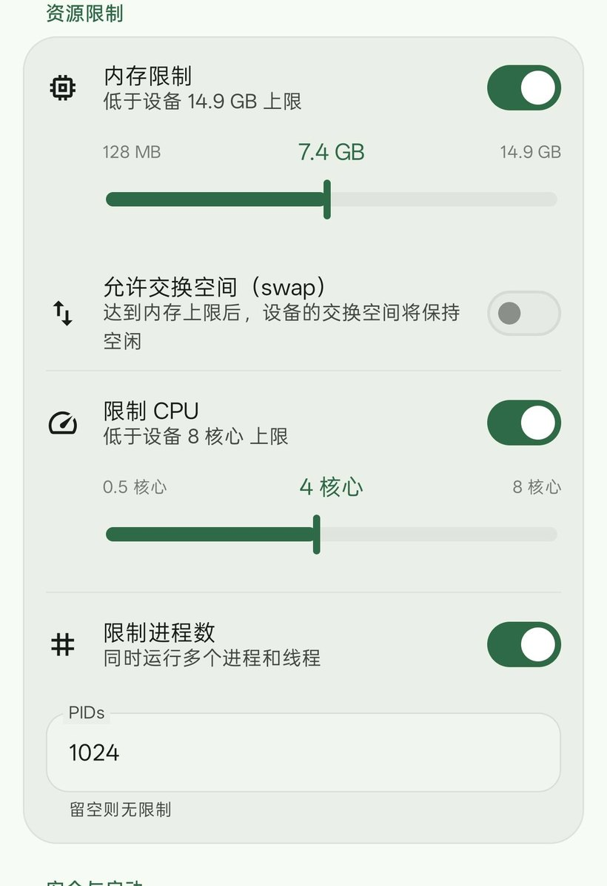
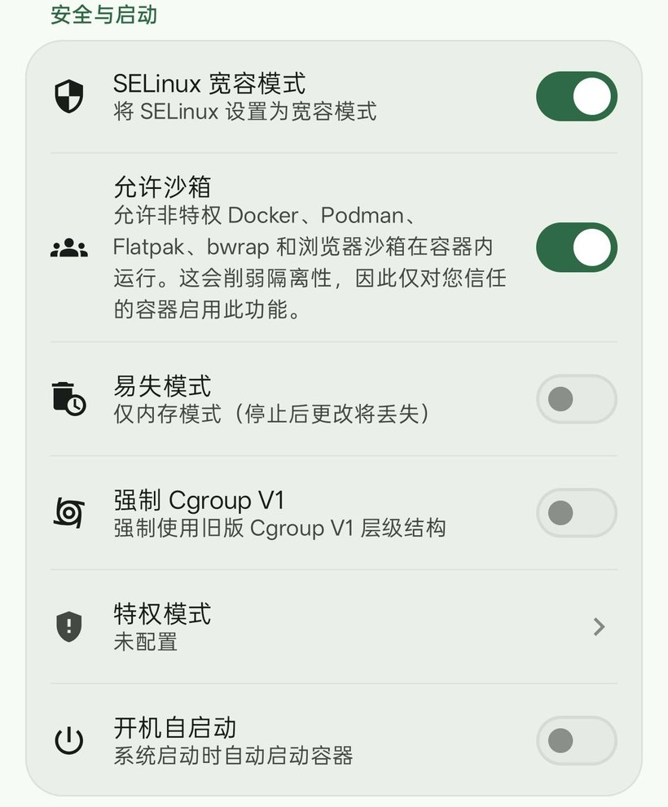
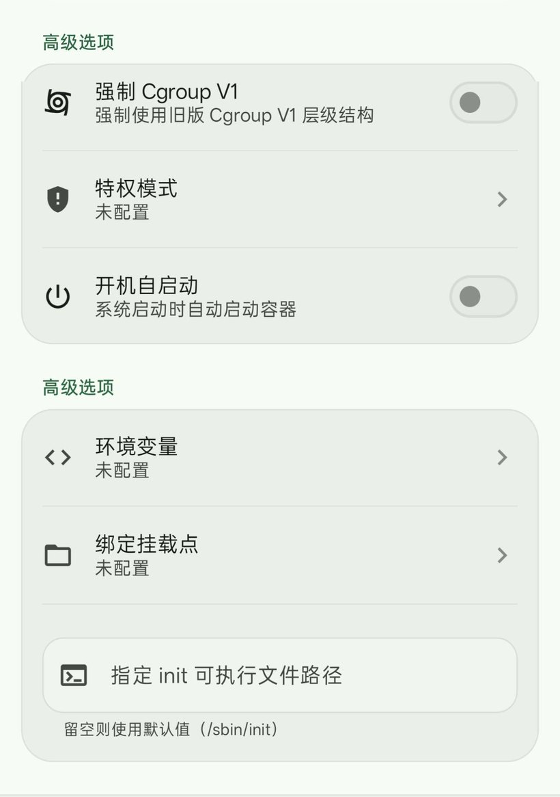
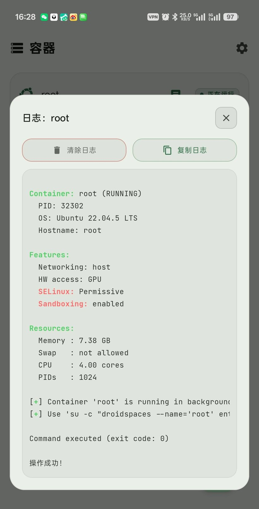
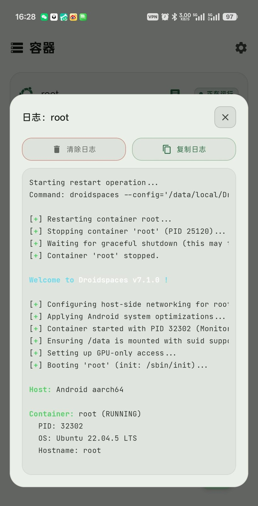

# Droidspaces 6.12 for OnePlus PMB110

在**原厂 GKI 内核**（不刷内核、不改 App 源码）上补齐 Docker / 容器运行时缺失的内核能力的 KernelSU 模块合集。

目标机型：**一加 Ace 6 至尊版（PMB110）**，内核 `6.12.69-android16-6-g242e1a07f878-ab15865446-4k`

```
当前版本   v1.0.20-6.12
状态       ✅ 稳定可用（真机验证通过）
最新内核   droid_lkm_misc.ko  md5 15fc08cbd67c06c3aa079bedd75b51bc
真机结果   容器可启动 · su 正常 · apt 可用 · 不崩溃
```

---

## 一分钟了解

这个仓库做三件事：

| 能力 | 做法 | 状态 |
|---|---|---|
| **PID / IPC / mqueue 命名空间** | `droid_lkm.ko` 运行时补 `CONFIG_PID_NS` / `CONFIG_IPC_NS` / `CONFIG_SYSVIPC` / `CONFIG_POSIX_MQUEUE` | ✅ 可用 |
| **devtmpfs** | `droid_lkm_misc.ko` 注册一个文件系统，给容器 `/dev` 提供设备节点 | ✅ 可用 |
| **pids 控制器** | `droid_lkm_pids.ko`，让 `--pids-limit` 真正生效 | ✅ 可用 |
| **macvlan / IPv6 NAT** | 独立模块，容器独立 IP | ✅ 可用 |
| **user namespace（容器独立 uid）** | ~~`droid_lkm_misc.ko` 内伪造 userns~~ | ❌ **做不到，已结案** |

---

## ⚠️ 必读：`CONFIG_USER_NS` 补不了

这是整个项目最重要的一条结论，**先看这里能省几天时间**。

本机内核**编译时就没有 `CONFIG_USER_NS`**，模块无法在运行时补出来。四条互相印证的证据：

| # | 证据 | 观察方式 |
|---|---|---|
| 1 | `unshare -U true` 返回 **EINVAL**（不是 EPERM） | 卸掉模块后执行，对应 `ksys_unshare()` 里 `#ifndef CONFIG_USER_NS return -EINVAL` |
| 2 | `/proc/config.gz` 里就是 `# CONFIG_USER_NS is not set` | `zcat /proc/config.gz \| grep USER_NS` |
| 3 | 容器进程 `uid_map` = `0 0 4294967295`（恒等映射） | `cat /proc/<pid>/uid_map` |
| 4 | `/proc/<pid>/ns/user` **文件不存在** | `ls -l /proc/<pid>/ns/` |

> **`/proc/sys/user/max_user_namespaces` 有值（62497）不代表支持 userns。** 那是厂商内核里的残留节点，
> 值是 `pid_max` 派生出来的。本项目早期被它误导了整整三天，为此写坏了六版代码、让手机重启两次。

**后果**：容器 root **就是**宿主 root，不存在"容器里的 uid 0 在宿主上是 200000"这回事。
`droid_lkm_misc.ko` 里那套 18 个 id 翻译钩子挂上了，但**翻译是恒等的**，不产生任何隔离。

详见 [`docs/PRINCIPLE.md`](docs/PRINCIPLE.md) 与 [`CHANGELOG.md`](CHANGELOG.md) 末尾的复盘。

---

## 目录结构

```
.
├── README.md                  ← 你在这里
├── STATUS.md                  ← 真机实测状态（这台 PMB110 的确切结论）
├── CHANGELOG.md               ← v1.0.0 → v1.0.20 演变，每版标注可用性
├── release/
│   ├── v1.0.20/               🟢 当前版本，直接装这个
│   │   ├── Droidspaces-v1.0.20-6.12.zip   完整 KernelSU 模块包
│   │   ├── droid_lkm_misc.ko              单独的内核模块（快速换）
│   │   ├── webui-index.html               单独换 WebUI 页面
│   │   ├── userns.sh                      属主转换脚本（含护栏）
│   │   ├── fake_config.sh                 伪装 config.gz（见下方警告）
│   │   └── Droidspaces-6.12-src-v1.0.20.zip
│   └── v1.0.19/               🟡 上一版，可回退
├── archive/                   ⚪ 历史包 v1.0.10 ~ v1.0.18（含 🔴 会崩的版本）
├── assets/app-ui/             🖼 App 界面截图（README「App 界面全解」用的）
├── src/                       📦 完整源码树
│   ├── droid_lkm/             内核模块 C 源码
│   ├── dsm/                   KernelSU 模块脚本 + WebUI
│   ├── dsm-pids/              pids 子模块
│   ├── net_macvlan/ net_ip6nat/
│   └── scripts/               构建与打包脚本
└── docs/                      📖 文档
    ├── tutorials/             ⭐ 教程（从零到跑起来 6 篇 + 移植自建 1 篇）
    ├── PRINCIPLE.md           原理（中）
    ├── en/                    英文版
    ├── TROUBLESHOOTING.md     ⭐ 踩坑记录，出问题先看这个
    └── HISTORY-userns-attempts-DEPRECATED.txt   失败路线的历史记录
```

---

## 教程：从零到跑起来

不想看原理、只想把东西用起来，直接进教程。每篇独立可看，命令能整段复制。

| # | 教程 | 讲什么 | 时间 |
|---|---|---|---|
| 1 | [安装与首次验证](docs/tutorials/01-install.md) | 刷模块、点「加载」、确认六件事 | 10 分钟 |
| 2 | [第一个容器](docs/tutorials/02-container.md) | 创建、启动、进入、配置项逐条解释 | 15 分钟 |
| 3 | [装软件](docs/tutorials/03-software.md) | apt、nginx、redis、python、服务自启 | 20 分钟 |
| 4 | [容器里跑 Docker](docs/tutorials/04-docker.md) | dockerd、镜像、端口、数据目录 | 20 分钟 |
| 5 | [传文件与备份](docs/tutorials/05-files.md) | 宿主↔容器、打包、迁移、恢复 | 15 分钟 |
| 6 | [升级 / 回退 / 卸载](docs/tutorials/06-maintenance.md) | 换版本、安全卸载、别踩的坑 | 10 分钟 |
| 7 | **[自己构建 / 适配你的手机](docs/tutorials/07-build-your-own.md)** | 换机型换内核时，怎么编出能 insmod 的 ko | 40 分钟 |

> 教程目录：[`docs/tutorials/`](docs/tutorials/README.md)。1~6 篇只适用于一加 Ace 6 至尊版（PMB110 / 6.12.69）。
> 第 7 篇是**移植**用的：教你把同一套源码编到你自己的机型上。

> **App 里每个开关该开还是该关 → 见下面 [App 界面全解](#app-界面全解)，8 张图。**

---

## App 界面全解

 

 

 

 

`01 一般` · `02 网络` · `03 硬件` · `04 资源` · `05 安全` · `06 高级` · `07 运行日志` · `08 重启日志`

---

## 安装

### 方式 A：完整包（推荐首次安装）

KernelSU → 模块 → 安装 → 选 `release/v1.0.20/Droidspaces-v1.0.20-6.12.zip` → 重启

首次安装**默认关闭开机自启**（`no_boot` 存在），需要手动点一次「加载」验证手机正常，
再回 WebUI 打开「开机自动加载」。

### 方式 B：只换内核模块（快，不用重启）

```sh
# 先把 droid_lkm_misc.ko 放到 /sdcard/Download/
su -c 'droidspaces --config=/data/local/Droidspaces/Containers/root/container.config stop
       echo 1 > /sys/module/droid_lkm_misc/parameters/release
       rmmod droid_lkm_misc
       cp /sdcard/Download/droid_lkm_misc.ko /data/adb/modules/Droidspaces/ko/
       insmod /data/adb/modules/Droidspaces/ko/droid_lkm_misc.ko real_userns=1 userns_any=1
       md5sum /data/adb/modules/Droidspaces/ko/droid_lkm_misc.ko'
```

md5 应为 `15fc08cbd67c06c3aa079bedd75b51bc`。

### 方式 C：只换 WebUI 页面（最轻）

```sh
su -c 'cp /sdcard/Download/webui-index.html /data/adb/modules/Droidspaces/webroot/index.html
       md5sum /data/adb/modules/Droidspaces/webroot/index.html'
```

md5 应为 `75f679574e0347b46eead02789b405a7`。

---

## 文件标注

### 🟢 `release/v1.0.20/` — 当前版本，用这个

| 文件 | 大小 | md5 | 用途 |
|---|---|---|---|
| `Droidspaces-v1.0.20-6.12.zip` | 7.2 MB | `fef08ae8ca10009632aee397c36d6e3c` | 完整包，KernelSU 刷入 |
| `droid_lkm_misc.ko` | 4.5 MB | `15fc08cbd67c06c3aa079bedd75b51bc` | 单独的内核模块 |
| `webui-index.html` | 75 KB | `75f679574e0347b46eead02789b405a7` | 状态页，防误点 |
| `userns.sh` | 12 KB | `4c49905b36aeeac95460730762eb42f1` | 属主脚本（relabel 已加护栏） |
| `fake_config.sh` | 1.8 KB | `2c5f89b7baed20a0544bd22064f43ade` | 见下方 ⚠️ |
| `Droidspaces-6.12-src-v1.0.20.zip` | 710 KB | `8a60aef52cd7192ba71c6a6b8a969ae1` | 源码快照（ko 相同，文档以本仓库为准） |

> 这些 zip 是**二进制交付物**，里面的 README / 教程是打包当天的快照。
> 之后文档有更新（纯图界面章、教程 07 等）只改仓库里的 `README.md` 和 `docs/`，不重打包 ——
> 重打包会改 md5，反而让 `checksums.txt` 对不上。看文档一律以仓库为准。

### 🟡 `release/v1.0.19/` — 可回退

只差 WebUI 判定逻辑，内核模块与 v1.0.20 **完全相同**（同一个 md5）。
v1.0.19 的页面会把"真 userns"显示成"已生效"、且「转换容器属主」按钮可点 —— 那是危险按钮，所以推 v1.0.20。

### 🔴 `archive/` — 历史版本，**其中三版会崩手机**

| 版本 | 状态 | 说明 |
|---|---|---|
| v1.0.18 | 🔴 **禁止使用** | `kernel_clone` 钩子在每次 fork 时换 cred → **两次整机重启** |
| v1.0.17 | 🟠 半成 | 建 ns 成功但子进程凭据未切换，容器 `su` 失败 |
| v1.0.16 | ⚪ 无效 | 挂错钩子（`fork`/`copy_creds`），Droidspaces 走的是 `unshare`，从未触发 |
| v1.0.15 | 🟡 可用 | 加卸载引用检查，防 UAF；但 userns 仍无 |
| v1.0.14 | 🟡 可用 | App 探测假成功 |
| v1.0.13 | 🟡 可用 | setgroups / uid_map 写入放行 |
| v1.0.12 | 🟡 可用 | toybox 兼容的 relabel 脚本 |
| v1.0.11 | ⚪ 旧 | relabel 脚本有 toybox 兼容问题 |
| v1.0.10 | ⚪ 旧 | 基线 |

> v1.0.0 ~ v1.0.9 与早期调试包（`droidspaces_6.12_v3` ~ `v36`）未收录，
> 那是开发过程中的临时构建，与当前结构不兼容。需要的话看 [`CHANGELOG.md`](CHANGELOG.md)。

### 校验下载的文件

```sh
md5sum -c checksums.txt --ignore-missing
```

### ⚠️ `fake_config.sh` 是双刃剑

它把 `/proc/config.gz` 里的 `CONFIG_USER_NS` / `CONFIG_DEVTMPFS` 改成 `=y` 再 bind mount 覆盖，
**纯粹是为了让 Droidspaces App 的能力探测过关**（App 读 `config.gz` 判定，不看 syscall）。

问题在于：**这也在骗使用者。** 它会让人（包括开发者本人）以为内核真的支持。
本项目为此绕了三天弯路，最后靠"卸载模块后 `unshare -U true` 看 errno"才定位。

保留它是因为「允许沙箱」显示 enabled 需要它；但它不提供任何真实能力。

---

## 真机状态（PMB110 / 6.12.69）

| 项 | 结果 |
|---|---|
| 六个模块加载 | ✅ 6/6 |
| 容器启动 / 进入 | ✅ 正常 |
| 容器内 `su` | ✅ 正常（不再 `cannot set groups`） |
| 容器内 `apt` | ✅ 可用 |
| pid namespace | ✅ 独立（与宿主不同 inode） |
| mnt namespace | ✅ 独立 |
| uts / net / cgroup / time | ✅ 独立 |
| user namespace | ❌ **不存在**（内核未编译） |
| 共享存储 `/storage/emulated/0` | ⚙️ 已关闭（`enable_android_storage=0`） |
| capability | ⚠️ 全量 32 个（含 `SYS_ADMIN`、`MKNOD`），配置改不了 |
| 开机自启 | ⚙️ 默认关闭，手动加载 |

完整实测记录见 [`STATUS.md`](STATUS.md)。

---

## 🚫 不要做的事

| 别做 | 原因 |
|---|---|
| 跑 `userns.sh relabel` / 点「转换容器属主」 | 内核没有 userns，改了就是**弄坏容器**：52 万文件改 200000 → `su: cannot set groups` → 再花 132 秒 restore |
| 装 v1.0.16 ~ v1.0.18 | 带 `kernel_clone` 换凭据的路，**会整机重启** |
| 建 `userns_adopt` 文件 | 同上，第二条崩溃路径 |
| 卸载模块前不 stop 容器 | `vfs_open → try_module_get` UAF，可能 panic |
| 相信 `max_user_namespaces` 有值 = 支持 userns | 残留节点，被骗三天 |
| 开「Android 存储」/ 往「绑定挂载点」写 `/sdcard` | 容器 root = 宿主 root，等于把相册、微信文件交给容器里的任何程序 |
| 开「硬件访问」 | 容器 `/dev` 拿到完整设备节点，配合 `CAP_MKNOD` 能碰块设备 |
| 内存 / CPU / PIDs 全拉满 | 容器能把手机吃死；PIDs 建议 ≥ 1024 给 Docker 用 |

---

## 安全模型（说清楚，不粉饰）

```
容器 root  ==  宿主 root        （无 userns，无法改变）
capability  ==  32 个全量       （含 SYS_ADMIN / MKNOD / SYS_PTRACE）
SELinux     ==  Permissive      （容器域 droidspacesd，只记日志不拦）
文件系统    ==  独立 rootfs + 独立 pid/mnt ns  ✅
网络        ==  net_mode=host，直接用宿主网络栈
```

**这个容器挡误操作，不挡有意为之。** 它的权限等价于你在 Termux 里 `su` 之后跑的东西，
只是把文件系统圈起来了。别当沙箱用。

- ✅ 适合跑：自己写的服务、`apt` 装的 nginx/redis、自己构建的镜像
- ❌ 不适合跑：来路不明的镜像、`curl xxx.sh | bash`、把它当隔离环境存密码

---

## 自己构建：适配你的手机

> 完整版（报错对照、自建 KDIR、崩机救援）→ **[教程 07](docs/tutorials/07-build-your-own.md)**。
> 这里只给最短路径和**能不能做**的判断。

### 先看边界：你的内核能拿到几个模块

`droid_lkm/Makefile` 里 `DLKM_OPT` 只对 6.6 / 6.12 放行后三个模块：

| 你的内核 | `droid_lkm.ko`（pid/ipc ns） | `vendor` / `misc` / `pids` |
|---|---|---|
| 6.12.x | ✅ 本机已验证 | ✅ |
| 6.6.x | ⚠️ 能编，未验证 | ✅ 能编 |
| 6.1 / 5.15 / 5.10 | ⚠️ 能编，未验证 | ❌ **不构建**，要自己改布局 |
| 非 GKI / < 5.4 | ❌ | ❌ |

编译环境必须是 **DDK 镜像**（内置匹配的 clang + KDIR），不能用系统 clang：

```
docker.cnb.cool/ylarod/ddk/ddk-min:android16-6.12       # tag = 你的 KMI
```

> 为什么这么死：6.12 内核开了 KCFI，编译器版本对不上，`insmod` 不是报错，是 `CFI failure` + **整机断电**。

### 五条命令

```sh
git clone https://github.com/ai-luo2006/droidspaces-6.12-pmb110.git
cd droidspaces-6.12-pmb110/src

sh scripts/fetch-deps.sh                    # 拉 4 个第三方工程（有离线快照）
sh scripts/build-ddkk.sh android16-6.12     # ← 换成你的 KMI
sh scripts/package-ksu-zip.sh               # → dist/Droidspaces-<version>.zip
```

产物在 `src/droid_lkm/out/<target>/`。可用 target：
`android12-5.10` `android13-5.10` `android13-5.15` `android14-5.15` `android14-6.1` `android15-6.6` `android16-6.12` `android17-6.18`。

### 三道锁要改成你的机器

`src/dsm/post-fs-data.sh` 里硬编码了三处：

| 位置 | 现在 | 改成 |
|---|---|---|
| 版本守卫 | `6.12.69-*` | 你的 `uname -r` 前缀 |
| 机型守卫 | `*PMB110*` | 你的 `ro.product.device` |
| vermagic 自检 | `vermagic=6.12` | 你的主版本 |

不想改代码，用开关文件先试（`no_precheck` 会连 vermagic 一起跳过）：

```sh
su -c 'touch /data/adb/modules/Droidspaces/allow_any_kernel
       touch /data/adb/modules/Droidspaces/no_precheck
       echo "<你的代号>" > /data/adb/modules/Droidspaces/allow_list'
```

### 加载顺序：一块一块上

```sh
su -c 'insmod .../ko/droid_lkm.ko gate=0 mqueue=1 nspid=1 nspid_append=1 skip_sysvipc=0 no_fake_ns=0 skip_do_exit=0'
su -c 'dmesg | grep -i droid_lkm | tail -30'
```

主模块不崩，再加 `vendor` → `misc` → `pids` → `macvlan` → `ip6table_nat`，每加一个看 `dmesg`。
**调试期留着 `no_boot` 文件**，崩了重启还能进系统。`droid_lkm_misc.ko` 在非 6.12 内核上最容易崩，
崩了就放弃它——只留主模块也能跑容器。

---

## 许可

见 [`src/LICENSE`](src/LICENSE) 与 [`src/THIRD-PARTY.md`](src/THIRD-PARTY.md)。
`droid_lkm` 系列模块为独立实现；Droidspaces App 本体不在此仓库内，本项目不修改其源码。
